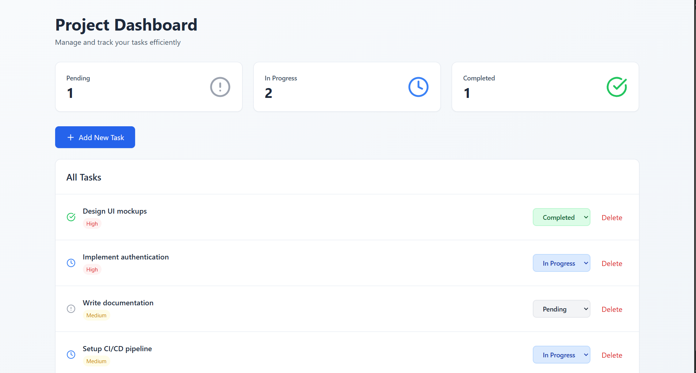

# Project Management Dashboard 

A simple and intuitive project management dashboard built with React that helps you track and manage tasks efficiently.

## Features

-  **Task Management** - Create, update, and delete tasks
-  **Status Tracking** - Track tasks across three statuses: Pending, In Progress, and Completed
-  **Priority Levels** - Assign priority levels (Low, Medium, High) to tasks
-  **Dashboard Statistics** - View real-time counts of tasks by status
-  **Modern UI** - Clean and responsive design with Tailwind CSS
-  **Real-time Updates** - Instantly see changes reflected in the dashboard

## Screenshot

